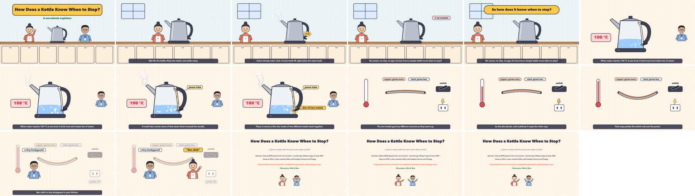

# Zero-Cost Video Toolkit

Make narrated explainer cartoons and simple music videos for $0, offline, on an Apple Silicon Mac.

You write a script in markdown. A local text-to-speech model reads it, Whisper times every word, and an HTML page draws each frame as SVG. Headless Chrome steps through the page frame by frame and FFmpeg turns the frames into a video. Nothing is sent to a cloud service unless you choose the optional paid music APIs.

Examples made this way: [Ben and Mei](https://charlestaysg.github.io/#ben-and-mei) and the videos on [youtube.com/@CharlesTay](https://www.youtube.com/@CharlesTay).



*The 67-second demo in this repo, one frame every 4 seconds.*

## What you need

| Tool | Why | Install |
|---|---|---|
| Apple Silicon Mac (M1 or later) | MLX runs the voice and Whisper models on the GPU | |
| Python 3.10+ | voice, timings, mix | `python3 -m venv .venv && .venv/bin/pip install -r requirements.txt` |
| [MLX-Audio](https://github.com/Blaizzy/mlx-audio) | runs Kokoro (voice) and Whisper (timings) | in `requirements.txt` |
| Node 18+ | drives Chrome | `brew install node` |
| Google Chrome | draws the frames | set `CHROME=/path/to/chrome` if it is not in `/Applications` |
| FFmpeg | encodes video, mixes audio | `brew install ffmpeg` |
| FluidSynth (optional) | turns a MIDI score into audio | `brew install fluid-synth` |

The first run downloads Kokoro-82M (about 330 MB) and Whisper large-v3-turbo (about 1.6 GB) into `~/.cache/huggingface`.

## Quick start

```sh
git clone https://github.com/charlestaysg/zero-cost-video-toolkit && cd zero-cost-video-toolkit
python3 -m venv .venv && .venv/bin/pip install -r requirements.txt
(cd cartoon/render && npm install)

PY=.venv/bin/python
$PY cartoon/tts.py cartoon/script.example.md --out out/audio          # 1. voice (seconds)
$PY cartoon/timings.py cartoon/script.example.md --audio out/audio    # 2. word timings
node cartoon/render/snap.js --count 24 --contact                      # 3. check frames
node cartoon/render/render.js                                         # 4. render (about 1.5 min)
python3 cartoon/mix.py --audio out/audio                              # 5. soundtrack
./cartoon/mux.sh out/video_silent.mp4 out/audio/final_mix.wav out/demo.mp4
```

Everything you generate lands in `out/`, which git ignores.

## The pipeline

1. **Script.** One `## S1 — Title` section per scene in a markdown file (see `cartoon/script.example.md`). Lines starting with `>` are notes. Write `{caption|spoken}` where the screen and the voice should differ: `{Mei|May}` fixes a name the voice gets wrong, `{100 °C|a hundred degrees Celsius}` spells a number out for the voice while the caption keeps the figure. Keep each scene under about 28 seconds of speech.
2. **Voice.** `tts.py` reads each scene with Kokoro-82M and writes `s1.wav`, `s2.wav` … plus `durations.json`. The default voice is `af_heart` at speed 0.9, which is about 160 words a minute. Use `--only S2` to redo one scene. For two or more characters, write `NAME: line` and use `tts_dialogue.py` with one `--voice NAME=voice:lang` per character (`PAUSE` inserts 3 seconds of silence, handy for quiz questions), then add `--dialogue` when you run `timings.py`. The engine's `talking(scene, "MEI", t)` tells you who is speaking at any moment.
3. **Timings.** `timings.py` runs Whisper on each clip, lines up what Whisper heard with your script, and writes `cartoon/render/words.js` (word times, captions, clip lengths) and `out/audio/timeline.json`. It also prints every place where Whisper heard something different. That doubles as a pronunciation check: if Whisper hears a name differently from how you meant it, respell the spoken half and redo that scene (`--only S2`).
4. **Scenes.** Edit `cartoon/render/scenes.js`. Each scene is a function of time. Cue every movement to a spoken phrase with `at(scene, "phrase")`, not to fixed seconds, so the animation follows the voice even after you change the voice, the speed or a sentence. The engine (`engine.js`) has easing helpers, cards, chips, speech bubbles, captions, two sample characters (Mei and Ben, plus a generic `person`) and a few backgrounds.
5. **Snapshots and contact sheet.** `snap.js --count 24 --contact` saves 24 evenly spaced frames and tiles them into `out/snaps/contact.jpg`. Look at it before every render. Layouts written by a language model nearly always have a few overlaps on the first pass. `snap.js` also reports page errors such as an anchor phrase that is not in the script.
6. **Render.** `render.js` loads `film.html` in headless Chrome, calls `window.seek(t)` for every frame at 25 fps and pipes JPEG frames to FFmpeg. Rendering is deterministic, so you can stop and resume (`START=1500 node render.js`) or render a short test (`END=250`).
7. **Mix.** `mix.py` places each clip at its scene start, adds a music bed (a soft synthesised pad by default, or your own tracks with `--music a.wav b.wav`), ducks the music under the voice with a sidechain compressor, and normalises to −16 LUFS. `--quiz-sfx` adds countdown ticks and a chime for `PAUSE` lines.
8. **Mux.** `mux.sh` joins the silent video and the mix and prints an `ffprobe` summary. Check that it shows both a video and an audio stream, and that the duration matches.

### Checklist before anyone else sees it

- `ffprobe` shows 1920×1080, 25 fps, one video and one audio stream.
- The contact sheet has no overlapping text, nothing off-screen, and captions land on the right words.
- Cut a 10-second slice at a scene start and listen: voice and pictures in step.
- Run Whisper over a slice of the final mix to confirm the music does not bury the voice.

## Music

- `music/example_score.py` writes a song as a JSON score (parts, notes like `C4:1`, chords like `[C4,E4,G4]:2`, drums like `kick:0.5`). Change a chord list or a melody bar and rebuild.
- `music/score_to_midi.py` turns the score into a standard MIDI file with no dependencies. Open it in GarageBand or any DAW, or render it straight to audio with `--wav out.wav --soundfont some.sf2` (FluidSynth). `--events` writes the time of every note, so visuals can land exactly on the beat.
- `music/mureka_song.py` and `music/eleven_music.py` call the paid Mureka and ElevenLabs music APIs for sung vocals. Both read the API key from an environment variable or the macOS Keychain (`--keychain-service` to pick the item); nothing is stored in files. Use `--dry-run` to see the request without spending anything. Mureka's result JSON includes per-word lyric timestamps, useful for lyric videos.

Generators that write the melody and the vocals together sound natural but will not follow your melody. Free offline singing synthesis that does follow a fixed melody still sounds robotic. Pick based on which matters more.

## Gotchas

- **Whisper model id.** Use `openai/whisper-large-v3-turbo` through `mlx_audio.stt.generate`. The `mlx-community/whisper-large-v3-turbo` copy fails with "Processor not found".
- **Whisper invents words at 30-second chunk boundaries** and over music or silence (for example "Thank you."). Keep scenes under about 28 seconds and treat text it hears in instrumental parts as noise.
- **Respell for the voice, not the captions.** Kokoro mispronounces some names and local words. `{caption|spoken}` keeps the screen correct.
- **Spell numbers out for the voice.** Write "twenty twenty-six", not "2026", in the spoken half.
- **Dotted abbreviations.** TTS voices tend to read "A.I." oddly; write "AI".
- **Scripts run short.** A script you expect to last 5 minutes often comes out nearer 3.5 at a natural pace. Time it after step 2, not before.
- **Fonts.** The film uses system fonts (Avenir Next, then Helvetica Neue). For other scripts, add a font that covers them, e.g. `local("PingFang SC")` for Chinese.
- **Chrome path.** `render.js` and `snap.js` default to `/Applications/Google Chrome.app`. Set `CHROME` otherwise.
- **macOS `say` voices** are licensed for personal, non-commercial use only. Kokoro is Apache 2.0.

## Files

| Path | What it does |
|---|---|
| `cartoon/script.example.md` | Demo script: three scenes about how a kettle switches itself off |
| `cartoon/script.dialogue.example.md` | Short two-voice dialogue with a quiz pause |
| `cartoon/script_parse.py` | Shared script parser (`## S1 — Title`, `{caption\|spoken}`, `NAME:` lines) |
| `cartoon/tts.py` | Narrates each scene with Kokoro-82M |
| `cartoon/tts_dialogue.py` | Voices a multi-character script, one Kokoro voice per character |
| `cartoon/timings.py` | Whisper word timings aligned to the script → `words.js`, `timeline.json` |
| `cartoon/mix.py` | Places clips, adds and ducks a music bed, optional quiz effects, −16 LUFS |
| `cartoon/mux.sh` | Joins video and audio, prints `ffprobe` |
| `cartoon/render/film.html` | The page Chrome renders; loads `words.js`, `engine.js`, `scenes.js` |
| `cartoon/render/engine.js` | Timeline, helpers, characters, backgrounds, captions, `at()` anchors |
| `cartoon/render/scenes.js` | Demo scenes; replace with your own |
| `cartoon/render/render.js` | Frame-by-frame render to MP4 |
| `cartoon/render/snap.js` | Snapshots and contact sheet |
| `music/example_score.py` | Example song written as a JSON score |
| `music/score_to_midi.py` | JSON score → MIDI (and WAV with FluidSynth) |
| `music/mureka_song.py` | Mureka music API client (paid) |
| `music/eleven_music.py` | ElevenLabs music API client (paid) |

## Licences

The code in this repo is MIT licensed (see `LICENSE`). The models and tools it calls have their own terms:

| Component | Licence |
|---|---|
| Kokoro-82M (voice) | Apache 2.0 |
| MLX-Audio | MIT |
| Whisper (OpenAI) | MIT |
| puppeteer-core | Apache 2.0 |
| FFmpeg | LGPL or GPL, depending on the build |
| FluidSynth | LGPL 2.1 |
| Google Chrome | Google's terms of service |
| MiniMax-Music, Mureka, ElevenLabs | Their own terms; checking them for your use is your responsibility |

If you use other voices, soundfonts or music models, check their licences too. Some popular ones are non-commercial only.

## Be honest

- Label the result as AI-generated: voice, music and visuals. The demo's credits do this.
- Cite your sources on screen when a scene makes a factual claim. `engine.js` has a `source()` helper for a small citation line.
- Don't put a number in the narration unless you have checked it against the original source. Explainers travel further than their corrections.
- Simplify, but say that you simplified.
